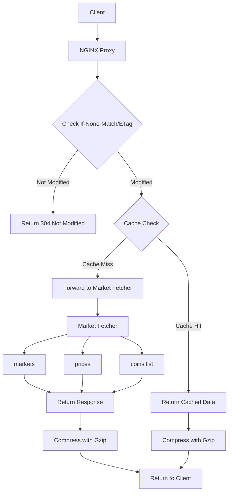

# Nginx Market Proxy

A proxy that performs caching, ETag optimization, and compression for displaying market data from market-fetcher.

## How It Works



The nginx market proxy handles requests through the following process:

1. Receives HTTP GET requests for market data:
   - `/v1/simple/price` - CoinGecko-compatible simple price endpoint
   - `/v1/coins/{coin_id}/market_chart` - CoinGecko-compatible historical price data with intelligent caching
   - `/v1/leaderboard/markets` - returns token market data from CoinGecko
   - `/v1/leaderboard/prices` - returns price data from Binance
   - `/v1/coins/list` - returns a list of tokens with their supported blockchain platforms
   - `/health` - returns service health status
2. Validates the request format
3. Checks if the requested data is available in the cache
4. For cached data:
   - Returns the cached data with appropriate headers
   - If data is not available, returns a 503 error
5. Periodically reloads market data configuration to maintain up-to-date information

## Local Development

run [../start-local.sh](../start-local.sh) to start the proxy locally.

see response format in [../market-fetcher/README.md](../market-fetcher/README.md) for more details.

## Request Format

Requests must be in one of the following formats:
```
GET /v1/simple/price?ids={coin_ids}&vs_currencies={currencies}
GET /v1/coins/{coin_id}/market_chart?days={days}&interval={interval}
GET /v1/leaderboard/markets
GET /v1/leaderboard/prices
GET /v1/coins/list
```

Examples:
```bash
# Get simple price data (CoinGecko-compatible)
curl -X GET "http://localhost:8080/v1/simple/price?ids=bitcoin,ethereum&vs_currencies=usd,eur"

# Get market chart data with intelligent caching
curl -X GET "http://localhost:8080/v1/coins/bitcoin/market_chart?days=7&interval=daily"

# Get market data
curl -X GET http://localhost:8080/v1/leaderboard/markets

# Get price data
curl -X GET http://localhost:8080/v1/leaderboard/prices

# Get tokens by platform (CoinGecko-compatible)
curl -X GET http://localhost:8080/v1/coins/list
```

## Caching

The proxy implements caching with the following features:
1. ETag-based caching to reduce bandwidth
2. Configurable cache TTL (Time To Live)
3. Automatic cache invalidation when new data is available

## Authentication

Protected endpoints accept either of two credentials ([auth.conf](auth.conf)):

1. **HTTP basic authentication.** Credentials are stored in `.htpasswd`.
2. **Puzzle JWT token.** A client solves a proof-of-work puzzle of the auth
   service ([proxy-common/auth](../proxy-common/auth/README.md)) and gets a
   short-lived token good for a limited number of requests:

```bash
# 1. Get a puzzle
curl http://localhost:8080/auth/puzzle

# 2. Solve it and exchange the solution for a token
curl -X POST http://localhost:8080/auth/solve -d '{"challenge": "...", "salt": "...", "nonce": 0, "argon_hash": "...", "hmac": "...", "expires_at": "..."}'

# 3. Use the token
curl -H "Authorization: Bearer <token>" http://localhost:8080/v1/leaderboard/markets
```

`go run ./auth/cmd/test-puzzle-auth http://localhost:8080` in `proxy-common`
runs the whole flow.

Protected endpoints: `/v1/leaderboard/prices`, `/v1/leaderboard/markets`,
`/v1/exchange_rates`, `/v1/coins/list`, `/v1/coins/markets`. `/auth/*` and the
other endpoints need no credentials.

### How a token is checked

The setup follows eth-rpc-proxy and nft-proxy: the proxy runs on OpenResty and
checks tokens in Lua ([lua/auth](lua/auth)).

- The auth service verifies a token once. A valid token is then remembered in
  the `jwt_tokens` shared dict until it expires, so later requests do not reach
  the auth service and keep working while it is down.
- Requests are counted per token in the same shared dict. A token past
  `requests_per_token` gets `401`, as does an invalid or expired one; the
  client is expected to solve a new puzzle.
- The token is taken from the `Authorization: Bearer` header only. Unlike
  eth-rpc-proxy, a token in the query string is not accepted: the query string
  is part of the proxy cache key and is passed to market-fetcher.
- The counter lives in the memory of one nginx instance, so with several
  replicas the limit applies per replica.

### Configuration

| Variable | Default | Meaning |
|----------|---------|---------|
| `GO_AUTH_SERVICE_URL` | `http://auth-service:8081` | Auth service address |
| `AUTH_CONFIG_FILE` | `/app/auth_config.json` | Auth config, the same file the auth service runs with |

The proxy reads `requests_per_token` and `token_expiry_minutes` from the auth
config at startup; restart it after changing them. `secrets/auth_config.json`
is created by [../start-local.sh](../start-local.sh) when missing.

### Lua tests

```bash
luarocks install busted
luarocks install lua-cjson
./lua_tests/run_busted_tests.sh
```
